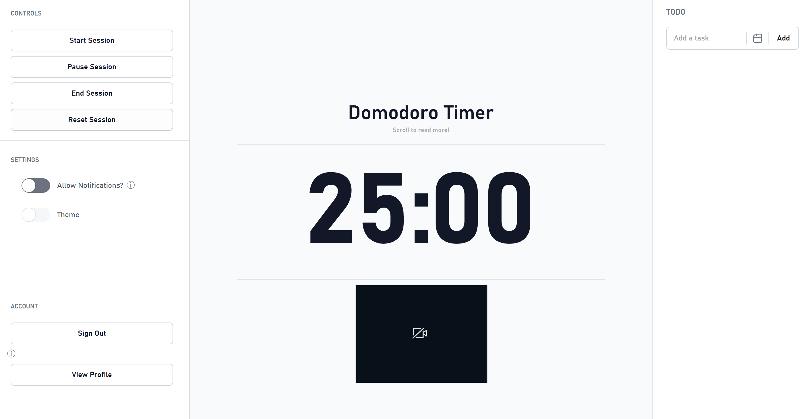
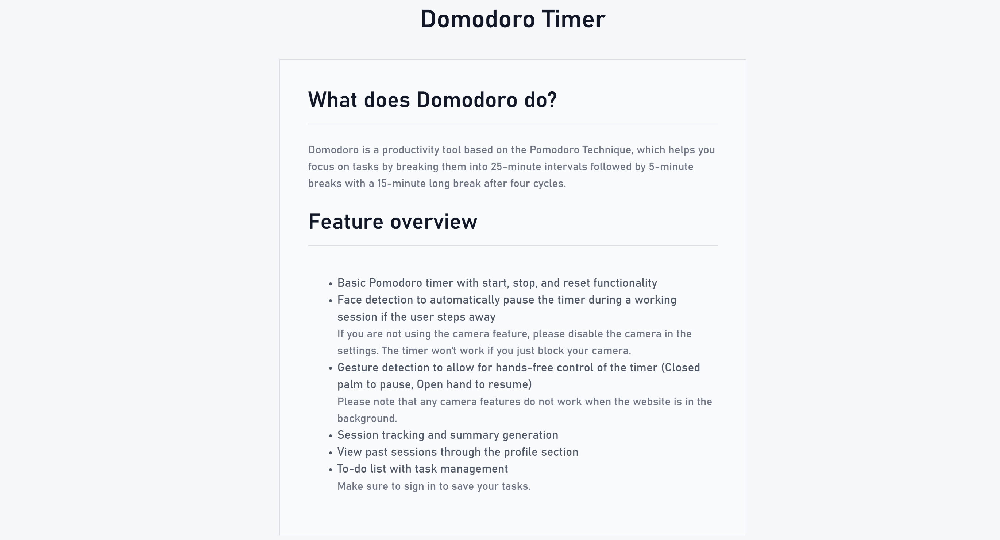

# Domodoro

Domodoro is a productivity web application designed to help users stay focused during study sessions. It combines a customizable focus timer with task management, session analytics, desktop notifications, and optional computer-vision features that can respond to user presence and gestures.

Live Demo: https://pomodoro-peach-two.vercel.app/

## Features

- Desktop notifications
- Task management with due dates
- User authentication
- Persistent user data with Supabase
- Focus-session and productivity tracking
- Historical analytics and visualizations
- Face detection for user-presence monitoring
- Gesture-based timer controls
- Light and dark themes

## Tech Stack

- React
- JavaScript
- Vite
- Supabase
- PostgreSQL
- MediaPipe
- Vercel

## How It Works

Domodoro is divided into several major parts:

- **Timer:** Manages focus and break sessions and tracks session activity.
- **Authentication:** Uses Supabase authentication to associate application data with individual users.
- **Tasks:** Stores and retrieves user tasks through Supabase.
- **Session Tracking:** Records study time, interruptions, completed tasks, and other session information.
- **Computer Vision:** Uses MediaPipe to detect user presence and gestures and interact with the timer.
- **Analytics:** Aggregates historical session data and displays productivity trends through visualizations.

## Screenshots

### Main Page

### Information/features page

